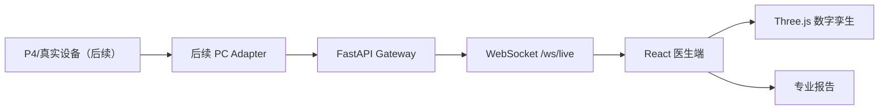
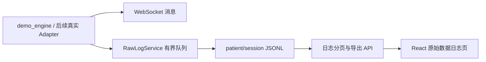

# 架构

当前项目实现 PC 医生端演示基线：

当前演示阶段由 `backend/app/demo_engine.py` 生成数据。后续接入真实设备时，PC 端只接收、保存、显示和生成报告，不建立第二套训练状态机。

新增数据可追溯链路：

## 主要模块

- `backend/app/main.py`：HTTP 和 WebSocket 入口。
- `backend/app/demo_engine.py`：演示场景插值与消息推送。
- `backend/app/websocket_hub.py`：多客户端广播和有界队列。
- `backend/app/session_store.py`：当前会话快照和报告隔离。
- `frontend/src/services/websocketClient.ts`：自动重连、快照同步。
- `frontend/src/store/rehabStore.ts`：session_id 和 seq 过滤。
- `frontend/src/twin/`：Three.js 解剖模型、肌肉高亮、骨架适配和参考轨迹。
- `backend/app/raw_log_service.py`：后台原始日志追加写入。
- `backend/app/log_export_service.py`：日志分页读取与 CSV/JSONL 导出。
- `frontend/src/layouts/PatientWorkspaceLayout.tsx`：患者工作区公共导航。

## 国赛演示收尾说明（2026-07-22）

本版本新增医生首页一键国赛演示入口，实时页采用 `body.glb` + 分段解剖网格运动映射。姿态由4个IMU相对四元数映射，sEMG固定为 CH1/CH2/CH3/CH4 四路业务肌肉归一化活动度。演示数据保持 `DEMO DATA` 标识，不代表真实临床结果。
