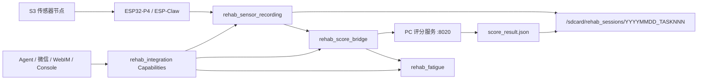
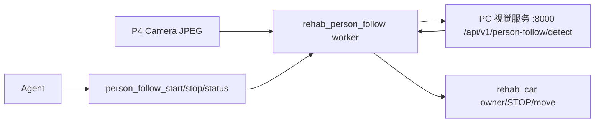
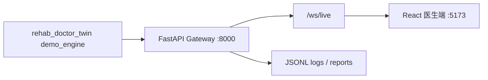

# Current Architecture

审计时间：2026-07-23

## 当前实际链路

## 责任边界

| 边界 | 负责方 | 不应承担 |
| --- | --- | --- |
| 训练状态真值 | ESP-Claw `rehab_sensor_recording` 当前 Recorder | 治疗师 UI 不能建立第二套训练状态机 |
| 任务选择真值 | ESP-Claw `rehab_task_decision` selected task | Agent 不从聊天历史猜任务名 |
| 训练数据合同 | ESP-Claw 写 frozen CSV + 七字段 `task.json` | PC 评分服务不修补/猜测缺失字段 |
| 正式评分计算 | PC 评分服务 | ESP 不在端侧重算算法 |
| 评分持久状态 | ESP `score_status.json` + PC job store | Agent 查询评分不触发重新提交 |
| 追人逐帧控制 | ESP `rehab_person_follow` worker | Agent 不逐帧调用车控 |
| 医生端展示 | `rehab_doctor_twin` backend/frontend | 当前不拥有 P4 真实训练状态 |
| 阿里云/LLM | ESP 通用 LLM 后端配置可指向 DashScope | 不等于康复数据云同步已实现 |

## 端口与冲突

| 服务 | 默认端口 | 冲突说明 |
| --- | --- | --- |
| PC 视觉服务 | 8000 | 与医生端后端相同，不能默认同时运行 |
| 医生端后端 | 8000 | Vite proxy 固定指向 `127.0.0.1:8000` |
| 医生端前端 | 5173 | 无冲突 |
| PC 评分服务 | 8020 | 独立 |
| P4 scan PC service | 8030 | 独立但未恢复 |

## 现状判断

当前系统不是一个已经完全打通的“P4 -> PC Adapter -> 医生端 UI -> 阿里云”生产闭环。实际可运行的成熟边界是：PC 视觉 8000、PC 评分 8020、医生端 demo 8000/5173 分别可启动；ESP 侧具备训练、评分桥、追人、扫描传输的源码合同，但本机没有 ESP-IDF 和真实 P4/热点验证。

推荐后续集成方向是在医生端后端旁新增真实 Adapter，订阅或拉取 ESP/PC 评分服务的既有合同，再转换成现有 `/ws/live` 消息。不要让前端直接调用 ESP 底层接口，也不要让评分服务承担 UI 会话状态。
